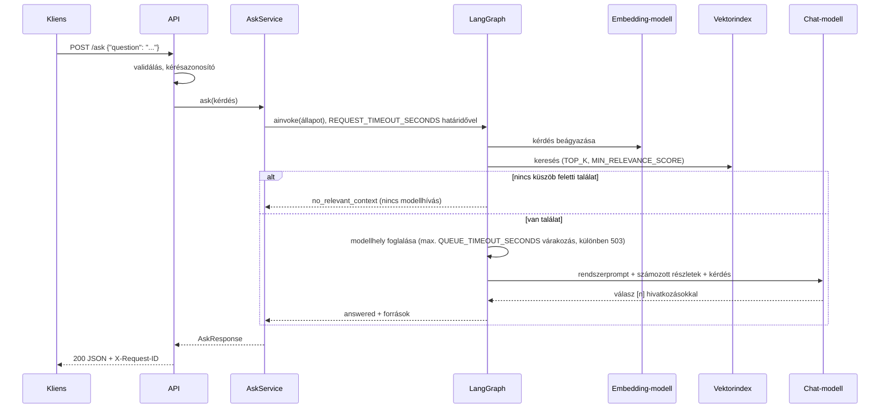
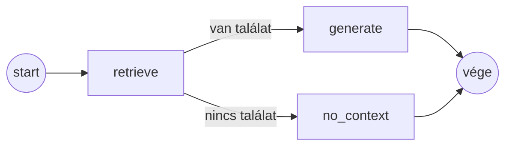

# policydesk

Kérdés-válasz backend belső szabályzatokhoz: egy munkatárs kérdésére a releváns szabályzatrészletek alapján válaszol, és megmutatja, mely dokumentumokból dolgozott. Python, FastAPI, LangGraph; felhős (OpenAI) és ingyenes lokális (Ollama) módban fut, a kettő között csak a konfiguráció különbözik.

**Tartalom**

1. [Probléma és képességek](#1-probléma-és-képességek)
2. [Gyorsindítás](#2-gyorsindítás)
3. [Architektúra](#3-architektúra)
4. [Telepítés, adat-előkészítés, futtatás, tesztek](#4-telepítés-adat-előkészítés-futtatás-tesztek)
5. [Modellkonfiguráció](#5-modellkonfiguráció)
6. [API](#6-api)
7. [Konkurens felhasználók és skálázás](#7-konkurens-felhasználók-és-skálázás)
8. [Ismert korlátok és következő lépések](#8-ismert-korlátok-és-következő-lépések)
9. [Követelmények nyomon követése](#9-követelmények-nyomon-követése)

## 1. Probléma és képességek

**Célfelhasználó:** egy budapesti tanácsadó cég (a kitalált *Pannonfield Advisory Kft.*) munkatársai.
**Igény:** gyors, pontos válasz olyan kérdésekre, mint „mennyi a napidíj Bécsben?” vagy „hány napot dolgozhatok külföldről?”. Ma ezt a munkatárs az intraneten keresi több szabályzatban, vagy megkérdezi a HR-t.
**Hogyan segít:** az alkalmazás a kérdéshez megkeresi a releváns szabályzatrészleteket, csak azok alapján válaszol, és visszaadja a felhasznált forrásokat. Így a válasz ellenőrizhető, és ha a szabályzatok nem fedik le a kérdést, ezt mondja meg, nem talál ki választ.

**Mintaadat:** 9 rövid, angol nyelvű, szintetikus szabályzat a [`data/policies/`](data/policies/) mappában (utazás és költségek, távmunka, szabadság, IT-biztonság, beilleszkedés, etikai kódex, képzés, adatvédelem, juttatások). Szándékosan konkrét összegeket, határidőket és kivételeket tartalmaznak, hogy a helyes visszakeresés látható legyen. Minden név, összeg és cím kitalált; bizalmas adatot nem tartalmaz. A szabályzatok angolok, mert egy nemzetközi cégnél ez a munkanyelv; **kérdezni magyarul és angolul is lehet**, a válasz a kérdés nyelvén érkezik.

**Képességek**

- `POST /ask`: kérdés → válasz a forrásrészletekkel (dokumentum, szakasz, hasonlósági pontszám, hivatkozott-e rá a válasz).
- Ha nincs elég releváns részlet, a válasz `no_relevant_context`, és a nyelvi modell **nem** kap hívást.
- Egységes hibaformátum minden hibára (érvénytelen kérés, modell-időtúllépés, szolgáltatói hiba, túlterhelés), kérésazonosítóval.
- `GET /health` állapotellenőrzés, OpenAPI-dokumentáció a `/docs` címen.
- Indexelés induláskor (csak akkor fut újra, ha a dokumentumok vagy az embedding-modell változtak), és modellellenőrzés még a forgalom fogadása előtt.
- JSON-naplózás kérésazonosítóval; a kérdés és a válasz szövege nem kerül a naplóba.

**Szándékosan nincs benne:** autentikáció és felhasználókezelés, beszélgetési előzmények, feltöltési API, frontend, streaming, reranking/hibrid keresés, RAG-minőségmérés. A feladatkiírás ezeket nem kéri; a [8. fejezet](#8-ismert-korlátok-és-következő-lépések) leírja, mikor lenne rájuk szükség.

## 2. Gyorsindítás

Előfeltétel: Docker Desktop (vagy Docker Engine) **Compose 2.20+** verzióval. A helyi módhoz kb. 8 GB szabad memória kell a Dockernek és kb. 13 GB lemez (részletek: [5.2](#52-ingyenes-lokális-mód-ollama)).

### Lokális mód (ingyenes, API-kulcs nélkül)

```bash
git clone https://github.com/Attila-Hartmann/policydesk.git
cd policydesk
cp .env.example .env          # PowerShell: Copy-Item .env.example .env
docker compose up --build
```

Az első indítás letölti az Ollama-image-et és a két modellt (kb. 3,7 GB modell), ezután indexel és ellenőrzi a modelleket. Akkor kész, amikor a naplóban megjelenik a `Uvicorn running on http://0.0.0.0:8000` sor (vagy a `docker compose ps` az `api` szolgáltatást `healthy`-nek mutatja). Egy másik terminálban:

```bash
curl -s -H "Content-Type: application/json" --data-binary "@examples/ask-en.json" http://localhost:8000/ask
```

PowerShellben `curl.exe`-t írj `curl` helyett (a `curl` ott az `Invoke-WebRequest` álneve). A kérés JSON-fájlból megy, így nincs idézőjel- és kódlapprobléma az ékezetes magyar kérdéseknél sem. Böngészőből: http://localhost:8000/docs.

### Felhős mód (OpenAI)

```bash
docker compose --profile local down   # ha a lokális mód fut (a profillal az Ollama-konténereket is leállítja)
cp .env.openai.example .env           # PowerShell: Copy-Item .env.openai.example .env
# írd be az OpenAI API-kulcsodat a .env fájl API_KEY= sorába
docker compose up --build
```

Ugyanaz az image és ugyanaz a kód fut, csak a `.env` más. Felhős módban az Ollama-szolgáltatások el sem indulnak.

## 3. Architektúra

### 3.1 Komponensek

```mermaid
flowchart LR
    client([HTTP-kliens]) --> api

    subgraph container["policydesk konténer"]
        serve["cli.py serve<br/>1. indexelés, ha kell<br/>2. modellellenőrzés<br/>3. uvicorn"]
        api["api.py<br/>útvonalak, hibakezelők,<br/>kérésazonosító"]
        svc["service.py<br/>határidő, válasz összeállítása"]
        graph["graph.py<br/>LangGraph: retrieve → generate | no_context"]
        prov["providers.py<br/>OpenAI-kompatibilis chat + embedding<br/>az egyetlen szolgáltatófüggő modul"]
        store["store.py<br/>vektorindex: mentés, betöltés, keresés"]
        serve --> api --> svc --> graph
        graph --> prov
        graph --> store
    end

    docs[("data/policies/*.md")] --> serve
    store <--> idx[("var/index.json")]
    prov -->|"OpenAI-kompatibilis HTTP"| llm["OpenAI API vagy Ollama"]
```

| Réteg (a kiírás szerint) | Modul | Felelősség |
|---|---|---|
| API-réteg | [`api.py`](policydesk/api.py), [`schemas.py`](policydesk/schemas.py) | Útvonalak, bemenetellenőrzés, hibaformátum, kérésazonosító, összeállítás (lifespan) |
| Alkalmazáslogika | [`service.py`](policydesk/service.py) | Kérésenkénti határidő, a gráf eredményéből válasz |
| RAG-folyamat | [`graph.py`](policydesk/graph.py), [`prompts.py`](policydesk/prompts.py), [`ingest.py`](policydesk/ingest.py) | LangGraph-gráf, prompt, darabolás és indexépítés |
| Modell- és tárolóintegráció | [`providers.py`](policydesk/providers.py), [`store.py`](policydesk/store.py) | OpenAI-kompatibilis kliens és hibafordítás; vektorindex |
| Konfiguráció | [`config.py`](policydesk/config.py), `.env` | Minden beállítás környezeti változóból, indításkori ellenőrzéssel |

Az `openai` csomagot egyetlen modul, a `providers.py` importálja. Ott fordítódnak le a szolgáltatói kivételek saját hibatípusokra (`ModelTimeout`, `ModelRateLimited`, `ModelError`), így a felsőbb rétegek nem tudják, melyik szolgáltató van mögöttük. A cserélhetőség két kis interfészen ([`ports.py`](policydesk/ports.py): `ChatModel`, `Embedder`) múlik; mindkettőnek van valódi és teszthez használt hamis megvalósítása.

### 3.2 Kérdés feldolgozása



### 3.3 A LangGraph-gráf



- `retrieve`: a kérdés beágyazása, keresés, a küszöb alatti találatok eldobása.
- `generate`: modellhely foglalása, a prompt összeállítása a találatokból, modellhívás, a válaszban hivatkozott `[n]` részletek megjelölése.
- `no_context`: rögzített, kétnyelvű válasz, modellhívás nélkül.

A gráf egyszer fordul le induláskor; a függőségei (modellek, index, szemafor) csak olvashatók. Minden kérésadat az `ainvoke`-nak átadott, kérésenként új állapotban él. A csomópontok nem kapják el a hibákat: azok az API hibakezelőihez jutnak, így a hiba → HTTP leképezés egy helyen van.

### 3.4 Indulás és indexelés

A konténer parancsa `python -m policydesk serve`:

1. **Indexelés:** a `data/policies/*.md` fájlok szakaszonkénti darabolása, beágyazása és a `var/index.json` atomikus írása. Ha az ujjlenyomat (darabok + darabolási paraméterek + embedding-modell) nem változott, az indexelés kimarad.
2. **Modellellenőrzés:** egy embedding- és egy apró chat-hívás. A rossz kulcs, egy elírt modellnév vagy egy le nem töltött modell így indításkor derül ki, érthető hibaüzenettel és 1-es kilépési kóddal, nem az első felhasználói kérdésnél. Lokális módban ez a modelleket is betölti a memóriába.
3. **API:** egy uvicorn worker (indoklás: [7. fejezet](#7-konkurens-felhasználók-és-skálázás)).

### 3.5 Projektstruktúra

```
policydesk/
├── policydesk/            # alkalmazás (rétegek: 3.1)
│   ├── api.py, schemas.py, service.py, graph.py, prompts.py
│   ├── ingest.py, store.py, providers.py, ports.py
│   ├── config.py, errors.py, logs.py, cli.py, __main__.py
├── data/policies/*.md     # szintetikus mintaadat
├── examples/*.json        # kipróbálható kérések
├── tests/                 # gyors tesztek hamis modellekkel
│   └── integration/       # végponttól végpontig, futó API ellen
├── docs/                  # követelmény-mátrix, terv, ADR-ek
├── Dockerfile, docker-compose.yml
├── .env.example           # lokális mód (alapértelmezés)
├── .env.openai.example    # felhős mód
└── pyproject.toml, uv.lock
```

### 3.6 Fő tervezési döntések

| Döntés | Választás | Fő alternatíva és miért nem | Részletek |
|---|---|---|---|
| Modellintegráció | Egy OpenAI-kompatibilis kliens minden módhoz (OpenAI, Ollama, Azure OpenAI v1) | Szolgáltatónkénti osztályok vagy LangChain-integrációk: ugyanaz a HTTP-hívás több kóddal és függőséggel | [ADR-001](docs/adr/001-one-openai-compatible-client.md) |
| Darabolás | Markdown-szakaszonként, a cím és a szakaszcím a darab elején; hosszú szakasz bekezdéshatáron vágva; determinisztikus azonosítók (`fájl:NN`) | Fix ablak átfedéssel: szabálypontokat vágna ketté, tokenizáló kellene hozzá | [ADR-002](docs/adr/002-section-chunking.md) |
| Vektortár | Pontos koszinusz-keresés NumPy-mátrixon, JSON-fájlban tárolva | Chroma/FAISS: 57 darabnál semmit nem nyerünk vele; pgvector / Azure AI Search: több példánynál és változó dokumentumoknál (következő lépés) | [ADR-003](docs/adr/003-in-memory-vector-index.md) |
| „Nincs releváns találat” | Embedding-modellenként kalibrált küszöb; nem hiba, hanem `200` modellhívás nélkül | Mindig modellt hívni és rábízni a „nem tudom”-ot: drágább, és egy kis lokális modell ebben megbízhatatlan | [ADR-004](docs/adr/004-relevance-threshold.md) |
| Hibakezelés | Egy hibaformátum, kérésenkénti határidő, SDK-újrapróbálás csak átmeneti hibákra, konkurenciakorlát gyors 503-mal | Hibák 200-as válaszban; saját újrapróbáló ciklus | [ADR-005](docs/adr/005-failure-policy.md) |
| Indexelés ideje | Induláskor, ujjlenyomattal kihagyva, ha nem változott semmi | Külön ingest-szolgáltatás és megosztott kötet: több mozgó alkatrész egy fájl kedvéért | [Terv, 10. pont](docs/plan.md) |

A LangGraph két lépéshez önmagában nem lenne szükséges; a kiírás kéri, és a feltételes él (van-e releváns találat) meg a típusos állapot az, ahol tényleg hasznos.

## 4. Telepítés, adat-előkészítés, futtatás, tesztek

### 4.1 Docker Compose-zal (ajánlott)

A [gyorsindítás](#2-gyorsindítás) lépései. Hasznos parancsok:

| Cél | Parancs |
|---|---|
| Indítás háttérben | `docker compose up -d --build` |
| Állapot | `docker compose ps` (az `api` legyen `healthy`) |
| Naplók | `docker compose logs -f api` |
| Leállítás | `docker compose --profile local down` (a letöltött modellek az `ollama` kötetben maradnak). Profil nélkül, felhős `.env`-vel a `down` nem látja az Ollama-konténereket. |
| Módváltás | `docker compose --profile local down`, másik `.env`, majd `docker compose up --build` |
| Minden törlése, modellekkel együtt | `docker compose --profile local down -v` |

### 4.2 Adat-előkészítés

Nincs külön lépés: induláskor a `serve` parancs elkészíti az indexet a `data/policies/*.md` fájlokból (lásd [3.4](#34-indulás-és-indexelés)). Saját dokumentumokhoz tegyél Markdown-fájlokat ugyanoda (`#` cím, `##` szakaszok), és indítsd újra a konténert; az ujjlenyomat változása miatt az index újraépül. Kézzel, Docker nélkül: `uv run python -m policydesk ingest`.

### 4.3 Docker nélkül

1. [uv](https://docs.astral.sh/uv/) telepítése:
   - macOS / Linux: `curl -LsSf https://astral.sh/uv/install.sh | sh`
   - Windows (PowerShell): `powershell -ExecutionPolicy ByPass -c "irm https://astral.sh/uv/install.ps1 | iex"`
2. Függőségek (a `uv.lock` szerint, szükség esetén Python 3.12-t is telepít): `uv sync`
3. Modellszerver: lokális módban [Ollama](https://ollama.com/download) a gépen, majd `ollama pull qwen3:4b-instruct` és `ollama pull bge-m3`.
4. Konfiguráció: `cp .env.example .env`, és a `.env`-ben `BASE_URL=http://localhost:11434/v1` (a gépen futó app az Ollamát `localhost`-on éri el, nem `ollama` néven). Felhős módban `.env.openai.example` és API-kulcs.
5. Indítás: `uv run python -m policydesk serve` → http://127.0.0.1:8000/docs

### 4.4 Tesztek

| Mit | Parancs | Mit igényel |
|---|---|---|
| Gyors tesztcsomag (84 teszt, kb. 5 s) | `uv run pytest` | Semmit: hamis modellek, nincs hálózat, nincs kulcs |
| Lefedettséggel (küszöb: 85%) | `uv run pytest --cov` | |
| Lint, formázás, típusok | `uv run ruff check .`, `uv run ruff format --check .`, `uv run mypy` | |
| Ugyanez uv nélkül | `docker build --target test .` | Docker |
| Integrációs tesztek (6 teszt) | `docker compose up -d --build`, majd ha az `api` `healthy`: `uv run pytest -m integration` | Futó API valódi modellekkel; a `API_URL` változóval más címre irányítható |

Az integrációs tesztek alapból ki vannak hagyva (`-m 'not integration'` a `pyproject.toml`-ban). Fekete dobozként a futó API-t hívják, ezért ugyanaz a csomag ellenőrzi a lokális és a felhős módot: angol kérdés a helyes szakaszból, magyar kérdés az angol szabályzatból, két dokumentumot érintő kérdés, témán kívüli kérdés modellhívás nélkül, üres kérdés 422-vel. A CI (GitHub Actions) minden pushnál futtatja a lintet, a típusellenőrzést, a gyors teszteket lefedettséggel, a Docker-buildet, a Compose-fájl ellenőrzését mindkét módban, és azt, hogy elérhetetlen modellnél a konténer érthető üzenettel, 1-es kóddal áll le.

A fontos működési utak tesztjei ([`tests/test_api.py`](tests/test_api.py)):

| Út | Teszt |
|---|---|
| Sikeres kérdés forrásokkal | `test_ask_returns_answer_with_sources` |
| Hibás bemenet (üres, csak szóköz, túl rövid/hosszú, hiányzó, rossz típus, extra mező, nem objektum, hibás JSON) | `test_invalid_input`, `test_malformed_json` |
| Üres találati lista, modellhívás nélkül | `test_no_relevant_context_does_not_call_model` |
| Modell-időtúllépés | `test_model_timeout_returns_504` |
| Modellhibák (rate limit, szolgáltató nem elérhető, elutasított hívás, túlterhelés) | `test_model_errors`, `test_embedding_error_uses_same_contract`, `test_overloaded_when_no_slot` |
| Váratlan hiba részletek kiszivárgása nélkül | `test_unexpected_error_is_500_without_details` |
| Párhuzamos kérések nem keverednek | `test_concurrent_requests_do_not_mix` |

## 5. Modellkonfiguráció

Mindkét mód ugyanazt az OpenAI-kompatibilis API-t használja; a módot a `.env` határozza meg:

| Változó | Lokális (`.env.example`) | Felhős (`.env.openai.example`) |
|---|---|---|
| `COMPOSE_PROFILES` | `local` (elindítja az Ollamát) | üres |
| `BASE_URL` | `http://ollama:11434/v1` | `https://api.openai.com/v1` |
| `API_KEY` | üres | a saját kulcsod |
| `CHAT_MODEL` | `qwen3:4b-instruct` | `gpt-6-luna` |
| `EMBEDDING_MODEL` | `bge-m3` | `text-embedding-3-large` |
| `REASONING_EFFORT` | üres (nem küldjük) | `none` |
| `MIN_RELEVANCE_SCORE` | `0.55` | `0.39` |
| `TOP_K` | `4` | `4` |
| `REQUEST_TIMEOUT_SECONDS` | `120` | `30` |
| `LLM_MAX_RETRIES` | `0` | `2` |
| `MAX_CONCURRENT_MODEL_CALLS` | `1` | `8` |
| `QUEUE_TIMEOUT_SECONDS` | `5` | `5` |

A hibás konfiguráció indításkor derül ki: a tartományon kívüli értékeket a változó nevével jelzi (az értéket nem írja ki, mert az kulcs is lehet); az elérhetetlen vagy rossz modellt a modellellenőrzés fogja meg.

### 5.1 Elsődleges, felhős mód: OpenAI

- **Chat: `gpt-6-luna`**, `reasoning_effort=none`. Az OpenAI jelenlegi leghatékonyabb modellje ([modelloldal](https://developers.openai.com/api/docs/models/gpt-6-luna), 2026. 11. 11.): 0,10 / 0,50 USD millió bemeneti / kimeneti tokenenként. A feladat a megadott részletekből válaszolni, nem következtetni, ezért a gondolkodást kikapcsoljuk (alapból `medium`), ami gyorsabb és olcsóbb. A modelloldal szerint EU-s adattárolással (data residency) is elérhető.
- **Embedding: `text-embedding-3-large`** (3072 dimenzió), 0,13 USD / millió token. Először a hatszor olcsóbb `text-embedding-3-small`-t választottam, de a kalibrálás megmutatta, hogy a magyar kérdéseket rosszul illeszti az angol szövegekhez: több magyar kérdésnél rossz szakasz lett az első találat, és a legrosszabb magyar kérdés pontszáma (0,266) a témán kívüli kérdések legjobbja (0,369) alá esett, így küszöbbel nem lehetett szétválasztani őket. A `3-large`-nál a két csoport szétválik (lásd lent). A költségkülönbség itt elhanyagolható: a teljes korpusz indexelése kb. 4 000 token, egy kérdés beágyazása kb. 20 token.
- **Mért költség és késleltetés:** a mintakérdéseknél 300–630 bemeneti és 40–120 kimeneti token, azaz kb. 0,0001 USD kérdésenként; a válaszidő 1,6–2,5 s, ebből a generálás 1,3–2,7 s. Az integrációs tesztcsomag (6 teszt) felhős módban 8 s alatt fut le.

**Relevanciaküszöb kalibrálása** (`text-embedding-3-large`, ugyanazzal a 36 kérdéssel, mint a lokális módnál, lásd 5.2):

| Kérdéscsoport | min | max |
|---|---|---|
| Témához tartozó, angol (12) | 0,458 | 0,722 |
| Témához tartozó, magyar (12) | 0,403 | 0,685 |
| Témán kívüli, angol és magyar (12) | 0,081 | 0,375 |

A küszöb `0,39`. A legmagasabb pontszámú témán kívüli kérdés itt a „Mi Magyarország fővárosa?” volt (0,375).

**Azure OpenAI:** az Azure v1 végpontja (`https://<erőforrás>.openai.azure.com/openai/v1/`) ugyanazt az API-t adja, így ugyanez a kód fut rajta: `BASE_URL` erre a címre, `API_KEY` az Azure-kulcs, a `CHAT_MODEL` és az `EMBEDDING_MODEL` pedig a telepítések (deployment) neve. Éles, EU-s üzemeltetéshez ez a természetes út (EU-régió, Entra ID, privát hálózat). **Ezt nem teszteltem**, mert nincs Azure-előfizetésem; ezért nincs hozzá mintakonfiguráció sem.

### 5.2 Ingyenes lokális mód: Ollama

**Modellek**

- **Chat: `qwen3:4b-instruct`** (Qwen3-4B-Instruct-2507, Q4_K_M, kb. 2,5 GB). Nem „gondolkodó” 4B-s instruct modell: CPU-n a gondolkodó modellek idejük nagy részét rejtett érveléssel töltenék. A méretéhez képest erős többnyelvű tudása van.
- **Embedding: `bge-m3`** (567M paraméter, 1,2 GB, 1024 dimenzió). Többnyelvű, így a magyar kérdés megtalálja az angol szabályzatot; nem kell hozzá lekérdezés/dokumentum előtag.

**Beszerzés és indítás**

- Docker Compose-zal (alapértelmezett): az `ollama` szolgáltatás futtatja a modellszervert, az egyszer lefutó `ollama-pull` letölti a `.env`-ben megadott `CHAT_MODEL` és `EMBEDDING_MODEL` modellt, ha még nincs meg. A modellek az `ollama` Docker-kötetben maradnak, a későbbi indítások internet nélkül is működnek. Az első letöltéshez internet kell.
- Ollama a gépen: telepítés az [ollama.com/download](https://ollama.com/download) oldalról, majd `ollama pull qwen3:4b-instruct` és `ollama pull bge-m3`. Ha a gépen futó Ollamát a konténerből használnád, akkor `BASE_URL=http://host.docker.internal:11434/v1` és `COMPOSE_PROFILES=` (üres) a `.env`-ben.

**Hogyan éri el az alkalmazás:** OpenAI-kompatibilis HTTP-n, a `BASE_URL` címen. Compose-on belül ez `http://ollama:11434/v1` (a szolgáltatás neve); a gépen futó alkalmazásból `http://localhost:11434/v1`. Az Ollama portja szándékosan nincs kinyitva a gép felé, hogy ne ütközzön egy már futó, natív Ollamával.

**Ollama-beállítások a Compose-ban:** `OLLAMA_NUM_PARALLEL=1` (CPU-n egyszerre egy generálás; ehhez igazodik a `MAX_CONCURRENT_MODEL_CALLS=1`), `OLLAMA_CONTEXT_LENGTH=8192` (a leghosszabb prompt kb. 2 000 token; a limit fölött az Ollama szó nélkül levágná), `OLLAMA_KEEP_ALIVE=1h` (a modellek a kérdések között a memóriában maradnak).

**Mért erőforrásigény** (Intel i7-1165G7, 4 mag / 8 szál, 40 GB RAM, dedikált GPU nélkül; Docker Desktop WSL2-vel, 8 CPU és 19,4 GiB memória a Dockernek):

| | Mért érték |
|---|---|
| Lemez | Ollama-image 8,5 GB, modellek 3,7 GB, alkalmazás-image 0,4 GB |
| Memória | Ollama-konténer kb. 5,1 GiB mindkét modellel betöltve (korábbi futásnál 7,5 GiB-ot is láttam); API-konténer kb. 100 MiB |
| Indulás (letöltött modellekkel) | 86 s a `healthy` állapotig: indexelés (57 darab) kb. 45 s, modellellenőrzés kb. 16 s |
| Válaszidő, új kérdés | 12–50 s (prompt-feldolgozás kb. 35 token/s, generálás kb. 4 token/s) |
| Válaszidő, ismételt kérdés | kb. 2 s (az Ollama gyorsítótárazza a prompt elejét) |
| Témán kívüli kérdés | 0,5 s alatt (nincs generálás) |

**Ajánlott minimum:** 4 CPU-mag, 8 GB szabad memória a Dockernek, 13 GB szabad lemez. GPU nem kell; NVIDIA GPU-val vagy Apple Silicon gépen natív Ollamával sokkal gyorsabb. **macOS-en** a Docker nem éri el a GPU-t, ezért ott a natív Ollama ajánlott (`BASE_URL=http://host.docker.internal:11434/v1`, `COMPOSE_PROFILES=`).

**Korlátok:** a lokális mód lassabb (CPU-n tíz-ötven másodperc egy válasz), és egyszerre egy kérdést dolgoz fel; a többi kérés legfeljebb 5 s várakozás után `503 overloaded` választ kap. A 4B-s modell válaszai tömörek és a tesztkérdésekre helyesek voltak, de a magyar fogalmazása néha nehézkes, és bonyolult, több feltételt kombináló kérdéseknél gyengébb a felhős modellnél.

**Relevanciaküszöb kalibrálása** (`bge-m3`, a legjobb találat pontszáma; mindegyik témához tartozó kérdésnél a helyes szakasz lett az első):

| Kérdéscsoport | min | max |
|---|---|---|
| Témához tartozó, angol (12) | 0,611 | 0,773 |
| Témához tartozó, magyar (12) | 0,586 | 0,748 |
| Témán kívüli, angol és magyar (12) | 0,297 | 0,529 |

A küszöb `0,55`. A rés kicsi (0,529 és 0,586 között); a legmagasabb pontszámú témán kívüli kérdés az „időjárás holnap Budapesten” volt, mert a szabályzatok említik a budapesti irodát. Ha más embedding-modellt választasz, a küszöböt újra kell kalibrálni: a [`scripts/calibrate.py`](scripts/calibrate.py) a fenti 36 kérdéssel kiírja a csoportonkénti pontszámokat (`uv run python scripts/calibrate.py`, futó modellszerverrel és felépített indexszel), egy-egy kérdésre pedig a `uv run python -m policydesk search "<kérdés>"` (chat-hívás nélkül). Részletek: [ADR-004](docs/adr/004-relevance-threshold.md).

## 6. API

Interaktív dokumentáció és kipróbálás: http://localhost:8000/docs (OpenAPI: `/openapi.json`).

### 6.1 `POST /ask`

Kérés: `{"question": "..."}`. A kérdés kötelező; a széleiről levágjuk a szóközöket, utána 3–500 karakter lehet. Más mezőt nem fogadunk el (elírásnál ne csendben hagyja figyelmen kívül).

Kipróbálható kérések az [`examples/`](examples/) mappában (bash és PowerShell alatt is működik, utóbbiban `curl.exe`-vel):

```bash
curl -s -H "Content-Type: application/json" --data-binary "@examples/ask-en.json" http://localhost:8000/ask
curl -s -H "Content-Type: application/json" --data-binary "@examples/ask-hu.json" http://localhost:8000/ask
curl -s -H "Content-Type: application/json" --data-binary "@examples/ask-cross.json" http://localhost:8000/ask
curl -s -H "Content-Type: application/json" --data-binary "@examples/ask-offtopic.json" http://localhost:8000/ask
curl -s -H "Content-Type: application/json" --data-binary "@examples/ask-empty.json" http://localhost:8000/ask
curl -s http://localhost:8000/health
```

A lenti válaszok lokális módban, a fenti kérésekkel készültek (a `request_id` rövidítve). Felhős módban ugyanezekre a kérdésekre bővebb válaszok jöttek; például a bécsi napidíjnál a modell az indulási és érkezési nap fél összegét (22,50 EUR) is megemlítette.

**Válasz forrásokkal** (`ask-en.json`: *How much is the daily meal allowance in Vienna?*):

```json
{
  "request_id": "be77650f…",
  "outcome": "answered",
  "answer": "The daily meal allowance in Vienna is EUR 45 [1].",
  "sources": [
    {"chunk_id": "travel-and-expenses:05", "document": "travel-and-expenses.md", "title": "Travel and Expenses Policy",
     "section": "Daily meal allowance", "score": 0.7379, "cited": true},
    {"chunk_id": "benefits:01", "document": "benefits.md", "title": "Benefits Overview",
     "section": "Cafeteria allowance", "score": 0.5972, "cited": false},
    {"chunk_id": "travel-and-expenses:04", "document": "travel-and-expenses.md", "title": "Travel and Expenses Policy",
     "section": "Accommodation", "score": 0.5787, "cited": false}
  ],
  "model": "qwen3:4b-instruct"
}
```

A `sources` a modellnek átadott összes részlet, a legjobb egyezéssel kezdve; a `cited` azt mutatja, hogy a válasz `[n]` formában hivatkozott-e rá.

**Magyar kérdés** (`ask-hu.json`: *Hány nap szabadság jár egy évben, és meddig vihetem át a ki nem vett napokat?*), rövidítve:

```json
{
  "outcome": "answered",
  "answer": "Egy évben egy munkavállalónak 25 munkanap szabadsága jár, és ha 5 vagy több évig szolgál, akkor 2 extra napot is kap [2]. A ki nem vett napokat maximum 5 napot lehet átviszni, és ezeket 31 márciusig kell felvenni, különben veszítik [1].",
  "sources": [
    {"chunk_id": "leave:03", "section": "Carrying leave over", "score": 0.6171, "cited": true, "…": "…"},
    {"chunk_id": "leave:01", "section": "Annual leave entitlement", "score": 0.613, "cited": true, "…": "…"},
    {"chunk_id": "remote-work:04", "section": "Working from abroad", "score": 0.5529, "cited": false, "…": "…"}
  ]
}
```

**Két dokumentumot érintő kérdés** (`ask-cross.json`): a válasz a távmunka-szabályzat alapján igen, két hétre dolgozhat Bécsből, de a külföldi távmunka nem kiküldetés, ezért napidíj nem jár; a források között a `remote-work.md` és a `travel-and-expenses.md` is szerepel.

**Nincs releváns találat** (`ask-offtopic.json`: *Who won the football World Cup in 2022?*), modellhívás nélkül:

```json
{
  "request_id": "6ff6f3f3…",
  "outcome": "no_relevant_context",
  "answer": "I could not find anything about this in the policy documents, so I cannot answer it. / Erről nem találtam információt a szabályzatokban, ezért nem tudok rá válaszolni.",
  "sources": [],
  "model": null
}
```

**Érvénytelen kérés** (`ask-empty.json`: csak szóközök), `422`:

```json
{
  "error": {
    "code": "invalid_request",
    "message": "The request body is invalid.",
    "retryable": false,
    "request_id": "19c2db95…",
    "details": [{"field": "question", "reason": "String should have at least 3 characters"}]
  }
}
```

### 6.2 `GET /health`

```json
{"status": "ok", "chat_model": "qwen3:4b-instruct", "embedding_model": "bge-m3",
 "index": {"documents": 9, "chunks": 57, "built_at": "2026-11-11T14:21:40+00:00"}}
```

Nem hívja a modellt. A modelleket az indításkori ellenőrzés már igazolta; egy pénzbe kerülő, külső szolgáltatótól függő állapotellenőrzés miatt egy szolgáltatói kiesésnél az orkesztrátor feleslegesen újraindítaná az egészséges konténereket. A szolgáltatói gondok a hibaarány- és késleltetésmetrikákban látszanak (7. fejezet).

### 6.3 Hibaformátum

Minden nem 2xx válasz ugyanilyen törzzsel és `X-Request-ID` fejléccel érkezik:

```json
{"error": {"code": "model_timeout", "message": "No answer within the 2 s request deadline.", "retryable": true, "request_id": "1668026e…"}}
```

| Helyzet | Státusz | `code` | `retryable` | Megjegyzés |
|---|---|---|---|---|
| Hibás JSON, hiányzó/üres/csak szóköz/túl rövid/túl hosszú kérdés, rossz típus, extra mező | 422 | `invalid_request` | nem | `details`: mező és ok; a beküldött értéket nem tükrözzük vissza |
| Ismeretlen útvonal / rossz metódus | 404 / 405 | `not_found` / `method_not_allowed` | nem | |
| A kérés határideje (`REQUEST_TIMEOUT_SECONDS`) lejárt | 504 | `model_timeout` | igen | |
| A szolgáltató korlátoz (429, az újrapróbálások után is) | 503 | `model_rate_limited` | igen | `Retry-After` |
| Nincs szabad modellhely `QUEUE_TIMEOUT_SECONDS` alatt | 503 | `overloaded` | igen | `Retry-After: 10` |
| Szolgáltatói 5xx vagy kapcsolódási hiba (újrapróbálás után) | 502 | `model_error` | igen | |
| A szolgáltató elutasította a hívást (400/401/403/404) | 502 | `model_error` | nem | Konfigurációs hiba; a naplóban a részletek |
| Váratlan hiba | 500 | `internal_error` | nem | Általános üzenet; a stack trace csak a naplóban |

A „nincs releváns találat” nem hiba (`200`). A hiányzó vagy más embedding-modellel épült index, illetve az elérhetetlen modell nem kérési hiba: ezekkel a szolgáltatás el sem indul. A hibás JSON-ra is 422 jön (a FastAPI szokása szerint): így a kliensnek egy ágon kell kezelnie a „hibás a kérésem” esetet, a `details` pedig megmondja, mi a baj.

Élő stacken ellenőrizve: lokális módban egy párhuzamos második kérésre 5,4 s után `503 overloaded` jött `Retry-After: 10`-zel; `REQUEST_TIMEOUT_SECONDS=2` beállítással 2,02 s után `504 model_timeout`. Felhős módban `REQUEST_TIMEOUT_SECONDS=0.3` mellett 0,31 s után `504 model_timeout`.

### 6.4 Naplózás

JSON-sorok a standard kimenetre. Minden sorban ott a `request_id`: a kérésben kapott `X-Request-ID` (ha biztonságos formájú, legfeljebb 64 karakter), különben egy generált azonosító, amely a válaszfejlécben és a hibatörzsben is visszamegy. Kérésenként: `retrieval` (találatok száma, legjobb pontszám, idő), `generation` (modell, idő, prompt- és válaszhossz tokenben, hivatkozott részletek száma) vagy `no_relevant_context`, végül `request` (metódus, útvonal, státusz, idő). **Soha nem naplózzuk** az API-kulcsot, a kérdés és a válasz szövegét (csak a hosszukat), mert egy munkatárs kérdésében személyes adat is lehet. Példa:

```json
{"ts": "2026-11-11T14:40:41.210+00:00", "level": "INFO", "logger": "policydesk.graph", "event": "generation", "request_id": "54b1ee17…", "model": "qwen3:4b-instruct", "ms": 24375, "prompt_tokens": 434, "completion_tokens": 97, "cited": 2, "answer_chars": 230}
```

## 7. Konkurens felhasználók és skálázás

A címkék: **[megvalósítva]** a kódban van és tesztelt; **[következő lépés]** amit éles terhelés előtt tennék.

**Kérések elkülönítése**

- [megvalósítva] Nincs megosztott, módosítható állapot. A lefordított gráf, a modellkliensek és az index induláskor jön létre, és utána csak olvassuk; a konkurenciakorlát szemafora erre készült. Minden kérésadat a kérésenként új gráfállapotban él, a kérésazonosító `contextvar`-ban, ami az asyncio-taskok között nem keveredik.
- [megvalósítva] A `test_concurrent_requests_do_not_mix` 20 párhuzamos kérést futtat eltérő késleltetéssel, hogy a válaszok összekeveredve érkezzenek, és ellenőrzi, hogy mindegyik a saját kérdésére kapott választ.
- [következő lépés] Ha a dokumentumoknak hozzáférési szintjük lesz: autentikáció, és a felhasználó jogosultságai szerinti szűrés már a keresésben (nem a válasz után).

**Párhuzamos végrehajtás**

- [megvalósítva] Végig aszinkron: `async` végpontok, aszinkron OpenAI-kliens közös kapcsolatkészlettel. A vektorkeresés egy 57 × 1024-es mátrixszorzás, mikroszekundumok, nem blokkolja az eseményhurkot. Az indexelés és a modellellenőrzés a forgalom előtt fut. A CPU-igényes munka, a lokális generálás, az Ollama folyamatában fut, nem a miénkben.
- [megvalósítva] Egy uvicorn worker, szándékosan: a kérések idejük nagy részében a modellre várnak, így több worker nem növelné az áteresztőképességet, viszont megtöbbszörözné a folyamatonkénti modellhívás-korlátot és a memóriabeli indexet.
- [következő lépés] Ha a dokumentumok futás közben változnak: az indexelés külön háttérfeladat (job) legyen. Ha a lokális mód válaszideje (fél perc) elfogadhatatlan egy kliensnek: aszinkron feladat-API (`202 Accepted` + lekérdezés vagy webhook) egy sor mögött, hogy ne tartsunk nyitva perces HTTP-kapcsolatokat.

**Erőforráskorlátok**

- [megvalósítva] Kérésenkénti határidő (`REQUEST_TIMEOUT_SECONDS`) a teljes folyamatra (beágyazás, várakozás, generálás); a legrosszabb válaszidő maga a határidő.
- [megvalósítva] Újrapróbálás csak átmeneti hibákra (kapcsolódási hiba, 408, 409, 429, 5xx), exponenciális visszalépéssel és jitterrel, a `Retry-After` fejléc figyelembevételével, és csak amíg a határidőből van idő. Lokálisan nincs újrapróbálás, mert egy túlfutott CPU-generálás újra is túlfutna, és dupla terhelést okozna.
- [megvalósítva] Folyamatonkénti konkurenciakorlát a chat-hívásokra (`MAX_CONCURRENT_MODEL_CALLS`); aki `QUEUE_TIMEOUT_SECONDS` alatt nem kap helyet, gyors `503 overloaded` választ kap `Retry-After`-rel, ahelyett hogy mindenki a határidőig várna.
- [következő lépés] Globális, példányokon átívelő korlát a szolgáltató RPM/TPM-kvótájához igazítva (Redis token bucket vagy API-gateway kvóta), circuit breaker, és tartalék modell egy második szolgáltatónál. Kérésméret-korlát a reverse proxyban.

**Több alkalmazáspéldány**

- [megvalósítva] Az API állapotmentes. Az indexet minden példány ugyanazokból a dokumentumokból ugyanúgy építi fel (determinisztikus darabolás, ujjlenyomat), így több példány mögé egy terheléselosztó tehető.
- [következő lépés] Ha a dokumentumok futás közben változnak, vagy a korpusz kinövi a memóriát: közös, tartós vektortár (pgvector vagy Azure AI Search) és egyetlen indexelő job; a példányok csak olvasnak. A modellhívás-korlátot ilyenkor el kell osztani a példányok között, vagy globálissá tenni (lásd fent).

**Szűk keresztmetszetek, metrikák, fejlesztési sorrend**

- A fő korlát a **modell áteresztőképessége**: lokálisan a CPU (egyszerre egy generálás, kb. 4 token/s), felhőben a szolgáltató RPM/TPM-kvótája és késleltetése. A keresés és az API mellette elhanyagolható.
- [megvalósítva] A naplók lépésenkénti időt, tokenszámot és kimenetelt tartalmaznak; ebből a metrikák utólag is számolhatók.
- [következő lépés] Metrikák (Prometheus vagy OpenTelemetry): p50/p95 idő lépésenként (beágyazás, keresés, várakozás, generálás); várakozási idő és sorhossz a szemaforon; `503 overloaded` arány; szolgáltatói 429/5xx/időtúllépés arány; token és költség kérésenként; `no_relevant_context` arány (ha nő, a dokumentumok vagy a küszöb hibásak).
- Sorrend: (1) a korlát és a határidő hangolása a mért p95 alapján; (2) metrikák és riasztás; (3) globális rate limit és újrapróbálási keret; (4) aszinkron feladat-API a lokális módhoz; (5) közös vektortár, amint a dokumentumok futás közben változnak; (6) gyorsítótár azonos kérdésekre, csak ha a forgalom ezt indokolja.

Külön terheléses tesztet nem futtattam; a párhuzamossági teszt és a túlterhelési út élő ellenőrzése (6.3) mutatja a viselkedést.

## 8. Ismert korlátok és következő lépések

**Korlátok és egyszerűsítések**

1. **Lokális válaszidő:** CPU-n 12–50 s egy új kérdésre, és egyszerre egy kérdés. A kiírás megengedi, hogy a lokális mód lassabb legyen; GPU-val vagy natív Ollamával Apple Siliconon gyorsabb.
2. **A relevanciaküszöb heurisztika:** a lokális modellnél a rés kicsi (0,529 és 0,586 között), így határeset-kérdések rossz oldalra eshetnek. Ha egy releváns szót tartalmazó, de témán kívüli kérdés átjut a küszöbön, a prompt utasítja a modellt, hogy mondja meg, ha a részletek nem fedik le a kérdést.
3. **Elutasítás `answered`-ként:** ha a modell a kapott részletek alapján nem tud válaszolni, a kimenetel `answered` marad, minden forrás `cited: false`. Szándékos: egy kis modell néha helyes válasznál is elhagyja a hivatkozást, és ezt nem akartam elutasításnak minősíteni.
4. **Prompt injection:** a részletek elválasztva és „hivatkozási anyag, nem utasítás” jelöléssel kerülnek a promptba, és a korpusz kurált. Ez nem garancia; a modellnek viszont nincsenek eszközei, így a legrosszabb eset egy rossz válasz, nem egy művelet.
5. **Nincs autentikáció**, és a `/health` kiírja a modellneveket. Prototípusnál elfogadható, élesben gateway vagy reverse proxy mögé kell tenni.
6. **Az index példányonként, a memóriában él**, és induláskor épül. Kis, ritkán változó korpuszhoz jó; nagyhoz vagy gyakran változóhoz nem (7. fejezet).
7. **Nincs kérésméret-korlát** az alkalmazásban: a kérdés hossza validált, de a törzs méretét a reverse proxynak kell korlátoznia.
8. **A 429 mindig `model_rate_limited`**, akkor is, ha az OpenAI a kimerült kvóta miatt adja (`insufficient_quota`); ilyenkor az újrapróbálás nem segít.
9. **A 4B-s lokális modell** magyar fogalmazása helyenként nehézkes, és több feltételt kombináló kérdésekben gyengébb.

**Következő lépések, prioritás szerint**

1. Metrikák és riasztás (7. fejezet), hogy a hangolás mért adatokon alapuljon.
2. Kis kiértékelő készlet (20–30 kérdés várt forrással) a küszöb és a darabolás ellenőrzéséhez minden változtatásnál, CI-kapuként.
3. Globális rate limit, circuit breaker, tartalék modell.
4. Aszinkron feladat-API a lassú lokális módhoz.
5. Közös vektortár és külön indexelő job, amikor a dokumentumok futás közben változnak; hibrid keresés (BM25 + vektor), ha a pontos kifejezések (pl. „TAJ-kártya”) keresése gyenge.
6. Autentikáció és dokumentumszintű jogosultság.
7. Beszélgetési előzmények, streaming, ha a felhasználói visszajelzés indokolja.

## 9. Követelmények nyomon követése

A kiírás minden követelménye számozva, a teljesítés helyével és bizonyítékával: [docs/requirements.md](docs/requirements.md). A tervezési kérdésekre adott válaszok és a tervezési review: [docs/plan.md](docs/plan.md); döntési feljegyzések: [docs/adr/](docs/adr/).
